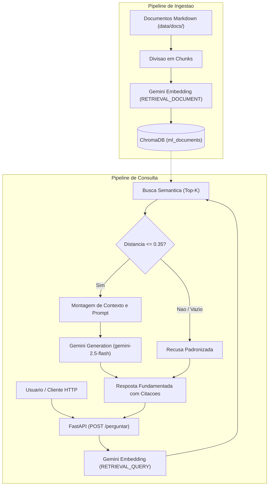

# RAG Tutor

Aplicação de Geração Aumentada por Recuperação (Retrieval-Augmented Generation — RAG) desenvolvida para responder dúvidas sobre fundamentos de Machine Learning utilizando exclusivamente documentos técnicos locais como fonte de conhecimento.

---

## Visão Geral

Modelos de linguagem de grande porte (LLMs) frequentemente enfrentam desafios de ancoragem factual quando consultados sobre domínios específicos. O RAG Tutor aborda esse problema desacoplando o conhecimento da parametrização interna do modelo: a base documental é indexada em um banco vetorial e os trechos mais pertinentes são recuperados e injetados diretamente no contexto da inferência.

O sistema orienta a geração para uma fundamentação estrita via engenharia de prompt: se a resposta não estiver contemplada nos documentos disponíveis ou a proximidade semântica estiver abaixo do limiar estipulado, o modelo é instruído a emitir uma recusa formal padronizada, reduzindo o risco de respostas inventadas ou inferências externas ao corpus.

---

## Funcionalidades

- **Ingestão de documentos técnicos:** Leitura e análise estrutural de arquivos Markdown com preservação de metadados de arquivo de origem e seção temática.
- **Divisão em chunks com sobreposição:** Segmentação de textos em blocos de até 3.000 caracteres com overlap de 400 caracteres, ajustando o ponto de corte para o final de sentenças (procurando ". ") quando aplicável.
- **Geração de embeddings semânticos:** Vetorização utilizando o modelo `gemini-embedding-001` via SDK oficial `google-genai` com tarefa explícita `RETRIEVAL_DOCUMENT` para armazenamento e `RETRIEVAL_QUERY` para consultas.
- **Armazenamento e busca vetorial:** Persistência no ChromaDB configurada com métrica de distância cosseno, em que distâncias menores indicam maior proximidade entre vetores.
- **Recuperação semântica parametrizada:** Consulta de top-K contextos relevantes com metadados e distâncias associadas.
- **Filtragem por distância máxima:** Descarte automático de trechos com distância superior a 0,35 (`DISTANCIA_MAXIMA`), mitigando ruído no contexto.
- **Recusa padronizada orientada por prompt:** Política de resposta que retorna *"Não encontrei essa informação nos documentos disponíveis."* quando não há contextos relevantes recuperados ou quando o modelo identifica ausência de suporte no texto.
- **Geração fundamentada com citações:** Prompt calibrado para instruir o modelo a citar o arquivo e a seção de referência entre colchetes em cada resposta.
- **API REST com validação de schemas:** Interface HTTP construída com FastAPI e validação síncrona de contratos via Pydantic.

---

## Arquitetura

O ciclo de vida da aplicação divide-se em duas etapas: o pipeline de ingestão offline e o pipeline de consulta online.

### Pipeline de Ingestão (Offline)
1. Os arquivos Markdown em `data/docs/` são lidos e particionados em seções.
2. O texto é dividido em chunks contíguos com sobreposição.
3. Cada chunk é enviado à API Gemini para geração de embedding vetorial (`RETRIEVAL_DOCUMENT`).
4. Os vetores, conteúdos de texto e metadados (`origem`, `secao`, `posicao`) são persistidos na coleção `ml_documents` do ChromaDB.

### Pipeline de Consulta (Online)
1. O usuário submete uma pergunta via endpoint HTTP `POST /perguntar`.
2. A pergunta é convertida em vetor de embedding (`RETRIEVAL_QUERY`).
3. O ChromaDB realiza a busca semântica por proximidade vetorial e retorna os documentos mais próximos com suas respectivas distâncias (menor distância = maior proximidade).
4. O gerador avalia as distâncias: se a lista estiver vazia ou todos os trechos excederem a distância máxima de 0,35, emite-se recusa imediata.
5. Os trechos válidos são estruturados em um prompt com instruções de ancoragem e regras de citação.
6. O modelo `gemini-2.5-flash` sintetiza a resposta final fundamentada nos trechos fornecidos.



---

## Tecnologias Utilizadas

- **Python (3.14.4):** Linguagem principal do ecossistema de aplicação, testes e automação.
- **FastAPI:** Framework web para construção da API REST com validação automática de tipos e documentação OpenAPI.
- **Google Gemini (`google-genai`):** Modelos de geração de linguagem (`gemini-2.5-flash`) e de incorporação vetorial (`gemini-embedding-001`).
- **ChromaDB:** Banco de dados vetorial embutido com persistência em disco para indexação e recuperação semântica.
- **Pytest:** Framework de testes unitários e de integração.
- **HTTPX:** Cliente HTTP utilizado para execução de testes automatizados de integração na API via `TestClient`.
- **Docker & Docker Compose:** Contêinerização da aplicação e orquestração de volume persistente para dados vetoriais.

---

## Estrutura do Projeto

```text
rag-tutor/
├── app/
│   ├── __init__.py
│   ├── config.py           # Variaveis de ambiente e configuracoes gerais
│   ├── generator.py        # Logica de filtragem, prompt e geracao LLM
│   ├── ingest.py           # Pipeline de leitura, chunking e indexacao
│   ├── main.py             # Inicializacao do FastAPI e definicao de rotas
│   ├── retriever.py        # Vetorizacao de query e consulta ao ChromaDB
│   └── schemas.py          # Modelos Pydantic de requisicao e resposta
├── data/
│   └── docs/               # Base de conhecimento de referencia em Markdown
│       ├── 01-introducao-ml.md
│       ├── 02-aprendizado-supervisionado.md
│       ├── 03-aprendizado-nao-supervisionado.md
│       ├── 04-treinamento-e-validacao.md
│       └── 05-metricas-avaliacao.md
├── eval/
│   ├── golden_set.json     # Conjunto de 20 perguntas de avaliacao
│   ├── run_eval.py         # Script de execucao do benchmark automatizado
│   └── results/
│       ├── baseline.json   # Resultados brutos, tempos e metricas do benchmark
│       └── manual_review.md # Auditoria qualitativa detalhada de cada resposta
├── tests/
│   ├── __init__.py
│   ├── test_api.py         # Testes de integracao do endpoint HTTP
│   ├── test_generator.py   # Testes unitarios do modulo gerador
│   └── test_retriever.py   # Testes unitarios do modulo recuperador
├── .dockerignore
├── .env.example
├── .gitignore
├── docker-compose.yml
├── Dockerfile
├── README.md
└── requirements.txt
```

---

## Avaliação do RAG

O sistema foi avaliado com um benchmark de 20 perguntas estruturado em `eval/golden_set.json`, composto por 16 perguntas respondíveis com base nos documentos e 4 perguntas intencionalmente fora do domínio (perguntas de controle negativo).

### Métricas de Desempenho

| Métrica | Resultado | Descrição |
| :--- | :---: | :--- |
| **Hit Rate@5** | **100,0%** | Proporção de consultas em que pelo menos um documento de referência esperado foi recuperado entre os 5 primeiros resultados (16 de 16). |
| **Correct Refusal Rate** | **100,0%** | Proporção de perguntas fora do domínio que foram corretamente recusadas sem tentativa de resposta sobre o tema externo (4 de 4). |
| **False Refusal Rate** | **0,0%** | Proporção de perguntas válidas que o sistema indevidamente se recusou a responder (0 de 16). |

### Tempos Médios Registrados

Os tempos a seguir refletem as médias observadas durante a execução do benchmark automatizado (`eval/results/baseline.json`):

- **Tempo médio de recuperação:** 0,75 segundos.
- **Tempo médio de geração:** 13,69 segundos.
- **Tempo médio total por requisição:** 14,45 segundos.

*Nota:* O tempo de geração médio observado inclui a latência de rede da API Gemini, processamento do prompt e eventuais esperas por políticas de cota/limites de requisição por minuto durante a execução sequencial do benchmark.

### Revisão Manual e Limitações Observadas

A análise manual qualitativa das 20 respostas geradas (`eval/results/manual_review.md`), confrontando cada resposta com os textos originais, registrou o seguinte balanço:

- **17 respostas Aprovadas** (incluindo 13 respostas técnicas e as 4 recusas corretas).
- **2 respostas Aprovadas com ressalva:**
  - **Pergunta 3 (Tipos de aprendizado):** O gerador explicou aprendizado supervisionado e não supervisionado, mas omitiu o aprendizado por reforço constante no documento introdutório, além de suprimir a extensão `.md` na citação.
  - **Pergunta 12 (Vazamento de dados):** A justificativa do motivo pelo qual o vazamento é prejudicial apresentou formulação circular (*"prejudicial porque pode prejudicar a avaliação"*), deixando de listar os exemplos práticos presentes no texto de validação (como pré-processamento global antes da divisão).
- **1 resposta Reprovada:**
  - **Pergunta 13 (Matriz de confusão):** O modelo indicou no texto a existência de quatro resultados na classificação binária, mas detalhou apenas dois (Falsos Positivos e Falsos Negativos), omitindo completamente os Verdadeiros Positivos e Verdadeiros Negativos, o que compromete a integridade da explicação.

---

## Testes Automatizados

A integridade do código é assegurada por uma suíte de 22 testes automatizados com Pytest. Todas as interações com serviços externos (Gemini e ChromaDB) são isoladas por meio de mocks, garantindo execução determinística, rápida e sem consumo de cotas de API ou dependência de conexão de rede.

### Divisão da Suíte de Testes
- **`tests/test_retriever.py` (6 testes):**
  - Recuperação correta de lista estruturada com documentos, metadados e distâncias.
  - Repasse correto do parâmetro `n_results` para a consulta do ChromaDB.
  - Tratamento de ausência ou formato inválido da variável `GEMINI_API_KEY`.
  - Tratamento de falha por coleção inexistente no banco vetorial.
  - Comportamento de retorno vazio quando o banco não localiza resultados.
- **`tests/test_generator.py` (9 testes):**
  - Recusa imediata quando a lista de contextos é vazia.
  - Recusa quando todos os contextos ultrapassam `DISTANCIA_MAXIMA = 0.35`.
  - Filtragem estrita para enviar ao prompt apenas contextos com distância <= 0,35.
  - Extração correta do texto da resposta com sanitização de espaçamento.
  - Tratamento de exceção quando o modelo retorna resposta vazia ou nula.
  - Tratamento de ausência de credencial de API.
  - Validação estática de preservação do threshold de corte de distância (0,35).
- **`tests/test_api.py` (7 testes):**
  - Resposta HTTP 200 com payload válido.
  - Validação da estrutura JSON de saída (`pergunta` e `resposta`).
  - Encaminhamento correto dos parâmetros entre rota, recuperador e gerador.
  - Rejeição com código HTTP 422 para perguntas curtas (< 3 caracteres).
  - Rejeição com código HTTP 422 para perguntas vazias.
  - Retorno da mensagem padronizada de recusa via endpoint.
  - Rejeição HTTP 422 para requisições sem corpo (body).

### Execução dos Testes

Com o ambiente virtual ativado:

```bash
pytest tests/ -v
```

---

## Configuração e Execução

### Pré-requisitos
- Python 3.14+ (ou versão compatível do interpretador)
- Chave de API do Google Gemini

### 1. Clonar o repositório
```bash
git clone <URL_DO_REPOSITORIO>
cd rag-tutor
```

### 2. Criar e ativar o ambiente virtual
```bash
python3 -m venv venv
source venv/bin/activate
```

### 3. Instalar as dependências
```bash
pip install -r requirements.txt
```

### 4. Configurar as variáveis de ambiente
Copie o arquivo de exemplo e preencha a chave de API:
```bash
cp .env.example .env
```
Edite o arquivo `.env` para inserir sua credencial do Gemini.

### 5. Ingerir os documentos
Antes de iniciar a aplicação, indexe a base de documentos Markdown no ChromaDB:
```bash
python -m app.ingest
```

### 6. Iniciar a API localmente
```bash
uvicorn app.main:app --host 0.0.0.0 --port 8000 --reload
```
A API estará acessível em `http://localhost:8000`.

---

## Execução com Docker

A aplicação está configurada para execução isolada em contêiner com suporte a persistência por volume nomeado para os dados do ChromaDB.

### 1. Construir e iniciar o serviço
```bash
docker compose up -d --build
```

### 2. Ingestão inicial no contêiner
Como o volume nomeado `chroma_data` é criado vazio na primeira execução e a base vetorial local não é copiada para a imagem (por estar no `.dockerignore`), execute a ingestão uma única vez dentro do contêiner:
```bash
docker compose exec rag-tutor python -m app.ingest
```

### 3. Consultar logs
```bash
docker compose logs -f
```

### 4. Encerrar o serviço preservando os dados
Para parar os contêineres sem remover o volume de dados do ChromaDB, execute:
```bash
docker compose down
```
*Atenção:* Não utilize a flag `-v`, pois ela removeria o volume nomeado e apagaria a base vetorial indexada.

---

## API

### Endpoint Principal

#### `POST /perguntar`

Submete uma pergunta sobre Machine Learning ao tutor.

**Cabeçalhos:**
```text
Content-Type: application/json
```

**Corpo da requisição:**
```json
{
  "pergunta": "O que é Machine Learning?"
}
```

**Exemplo de resposta (HTTP 200):**
```json
{
  "pergunta": "O que é Machine Learning?",
  "resposta": "Machine Learning, ou aprendizado de máquina, é uma área da inteligência artificial que desenvolve métodos capazes de identificar padrões em dados e utilizar esses padrões para realizar previsões ou tomar decisões [01-introducao-ml.md, O que é Machine Learning].\n\nEm vez de programar manualmente todas as regras para cada situação, são fornecidos exemplos a um algoritmo para que ele ajuste um modelo a partir desses dados [01-introducao-ml.md, O que é Machine Learning]."
}
```

**Exemplo de recusa para pergunta fora de escopo (HTTP 200):**
```json
{
  "pergunta": "Qual é a capital da França?",
  "resposta": "Não encontrei essa informação nos documentos disponíveis."
}
```

**Possíveis Códigos de Resposta HTTP:**
- `200 OK`: Pergunta processada com sucesso (resposta gerada ou recusa padrão).
- `422 Unprocessable Entity`: Erro de validação nos dados enviados (ex.: pergunta com menos de 3 caracteres ou corpo ausente).
- `500 Internal Server Error`: Erro interno no processamento ou indisponibilidade de serviço externo.

### Documentação Interativa
Com a aplicação em execução, a documentação Swagger UI pode ser acessada em:
```text
http://localhost:8000/docs
```
E a documentação alternativa ReDoc em:
```text
http://localhost:8000/redoc
```

---

## Variáveis de Ambiente

As configurações são gerenciadas a partir de variáveis de ambiente carregadas em `app/config.py`:

| Variável | Padrão | Descrição |
| :--- | :--- | :--- |
| `GEMINI_API_KEY` | *(Obrigatório)* | Chave de autenticação para acesso às APIs do Google Gemini. |
| `GEMINI_GENERATION_MODEL` | `gemini-2.5-flash` | Identificador do modelo generativo utilizado na sintetização de respostas. |
| `GEMINI_EMBEDDING_MODEL` | `gemini-embedding-001` | Identificador do modelo de embedding utilizado para vetorizar documentos e consultas. |
| `CHROMA_PATH` | `./.chroma` | Diretório no sistema de arquivos onde o ChromaDB persiste os dados vetoriais (no Docker: `/app/.chroma`). |
| `COLLECTION_NAME` | `ml_documents` | Nome da coleção utilizada para armazenar os chunks vetoriais no ChromaDB. |

---

## Limitações e Melhorias Futuras

### Limitações Atuais
- **Pipeline de ingestão síncrono:** A ingestão reconstrói toda a coleção deletando-a previamente, o que não é escalável para bases documentais de grande volume.
- **Truncamento em enumerações:** Conforme identificado na revisão manual (Pergunta 13), o gerador pode sintetizar parcialmente listas ou quadrantes ao invés de listar integralmente os itens descritos no trecho de contexto.
- **Dependência de chamadas externas em produção:** A inferência online depende diretamente da disponibilidade e das taxas de requisição por minuto da API pública do Google Gemini.

### Melhorias Futuras
- **Ajuste fino de prompt para enumerações:** Instruir o modelo a checar a exaustividade de categorias ao responder perguntas de definição e classificação.
- **Reranking de contextos:** Incorporação de um modelo de reranking (Cross-Encoder) após a recuperação vetorial inicial para refinar a ordenação dos trechos mais relevantes.
- **Histórico conversacional:** Evolução do endpoint atual para suporte a diálogos multi-turn com gerenciamento de estado de sessão.
- **Ingestão incremental:** Atualização por delta de arquivos modificados através de hashing de conteúdo, dispensando a recriação total da coleção vetorial.
